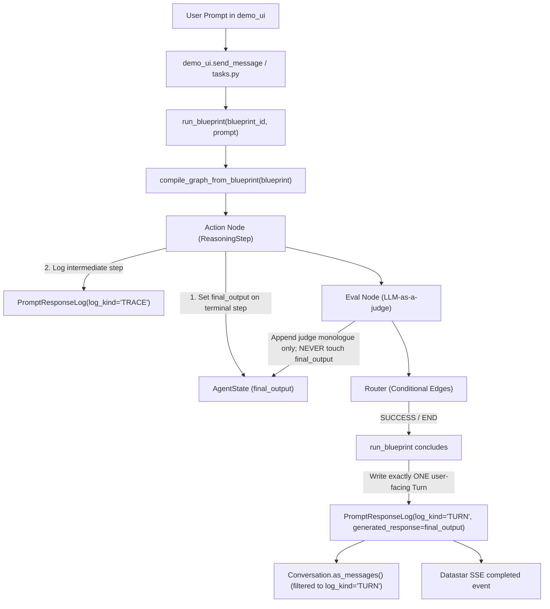

# Workstream 27 Specification: Metacognition Harness Architecture & Output Contract

## 1. Executive Summary & Problem Definition
When running the `Deep_Reader` cognitive blueprint via the Reason `demo_ui` chat interface, the final response presented to the user is a raw JSON schema container rather than a synthesized conversational answer or distilled knowledge.

An architectural investigation and empirical test probe (`probe_deep_reader.py`) confirmed that this is not an isolated edge-case in one blueprint, but the symptom of three core architectural gaps across the execution harness:
1. **Absence of an Explicit Output Contract**:
   - `tasks.py::run_blueprint` extracts the final answer via `final_response = monologue[-1]["output"]`.
   - Because the LangGraph compiler attaches an evaluation node (`_make_eval_node`) after every action step, the final entry in `internal_monologue` for any blueprint with `evaluation_criteria` is the evaluation judge's verdict (`Evaluation Result: SUCCESS...`).
   - For 18 of 27 seeded blueprints, the final response is either the evaluator's critique or a raw JSON/Pydantic schema dump.
2. **Dual-Use Identity Collision in `PromptResponseLog`**:
   - `PromptResponseLog` is currently used simultaneously as the detailed internal execution trace (recording every intermediate tool call, judge check, and scratch state) AND as the conversational transcript (`Conversation.as_messages()`).
   - The initial streaming placeholder log in `demo_ui` is overwritten by the first intermediate tool call in `ai_service._log_generation(initial_log_id=...)`.
   - Intermediate evaluation judge logs fork the DAG, and the latest created log (the judge verdict) becomes the default "leaf" for chat display on reload and subsequent conversational turns.
   - In `Conversation.as_messages()`, `leaf_log_id` is queried as a `str` against `UUID` dictionary keys, falling back to chronological tail and pulling raw tool-call JSON and evaluation payloads into future LLM context windows.
3. **Consumer Mismatch in the UI**:
   - The demo UI blueprint selector does not distinguish between blueprints designed as conversational answer engines (`ANSWER`), intermediate knowledge retrievers (`CONTEXT`, e.g., `Deep_Reader`), artifact builders (`ARTIFACT`), and background graph maintenance tasks (`MAINTENANCE`).

---

## 2. Target Architecture Overview



---

## 3. Phased Implementation Plan

### Phase 0: Contract Test Harness (Reproduction & Verification)
Establish reproducible contract tests in `metacognition/tests.py` using an isolated test database (zero reliance on external inference servers or network calls):
1. **`test_deep_reader_output_contract`**: Proves that running `Deep_Reader` produces a human-readable distilled context, not evaluator JSON or raw tool calls.
2. **`test_turn_vs_trace_isolation`**: Proves that running a multi-step blueprint generates intermediate `TRACE` logs without corrupting the top-level `TURN` transcript.
3. **`test_as_messages_uuid_leaf_resolution`**: Proves that `Conversation.as_messages(leaf_log_id=str(log.id))` resolves UUID keys accurately and excludes intermediate trace records.

### Phase 1: Core Output Contract & Transcript Isolation
1. **Schema & Model Updates (`metacognition/models.py`)**:
   - `CognitiveBlueprint`:
     - Add `output_kind = models.CharField(max_length=20, choices=[('ANSWER', 'Conversational Answer'), ('CONTEXT', 'Context / Retrieval Provider'), ('ARTIFACT', 'Synthesized Artifact'), ('MAINTENANCE', 'System / Graph Maintenance')], default='ANSWER', db_index=True)`
   - `ResponseSchema`:
     - Add `display_field = models.CharField(max_length=255, blank=True, help_text="Attribute extracted for conversational display when output is structured JSON/Pydantic.")`
     - Add method `format_for_display(raw_data) -> str` to cleanly extract the display field or render markdown.
2. **State Updates (`metacognition/state.py`)**:
   - Add `final_output: Annotated[Optional[str], override_last]` to `AgentState`.
3. **Compiler Refinements (`metacognition/compiler.py`)**:
   - In `_make_action_node`: If the step is terminal (no `on_success_step` or reaching terminal state), populate `state["final_output"]` from the step's generated text, schema display extraction, or tool resolution.
   - In `_make_eval_node`: Strict invariant: `eval_node` records its reasoning in `state["evaluator_feedback"]` and monologue, but never silently replaces `final_output` with a raw judge verdict.
   - On evaluation failure halting at `END`: `tasks.py::run_blueprint` synthesizes the candidate output with the evaluator's critique so the user receives an explanatory, actionable response:
     ```markdown
     {candidate_output}

     ---
     > ⚠️ **Evaluation Notice**: The proposed response did not satisfy all verification criteria.
     > **Evaluator Critique**: {evaluator_reasoning}
     ```
4. **Log Kind Separation (`llm_api/models.py`)**:
   - `PromptResponseLog`: Add `log_kind = models.CharField(max_length=10, choices=[('TURN', 'Conversation Turn'), ('TRACE', 'Intermediate Execution Trace')], default='TURN', db_index=True)`.
   - Update `Conversation.as_messages()`: Filter default path to `log_kind='TURN'`. Fix `leaf_log_id` lookup so `UUID(leaf_log_id)` and `str` lookups both resolve reliably.
   - **Trace & RAG Interrogability Guarantee**: `TRACE` logs are NOT hidden or deleted. `group_conversation_logs_for_display` in `demo_ui` attaches all `TRACE` records to `log.thinking_steps`, preserving the interactive `💭 Thinking Trace` accordion. Retrieved RAG sources are aggregated into `log.rag_selections`, preserving the `Attached Context` `<details>` block.

5. **Execution Harness Updates (`metacognition/tasks.py`)**:
   - In `run_blueprint`:
     - Prioritize `result_state.get("final_output")` as `final_response`.
     - Filter out any fallback monologue entry whose `step_name` ends with `"(Evaluation)"`.
     - Log/finalize exactly one `PromptResponseLog(log_kind='TURN')` containing the actual `final_response`.
     - Intermediate LLM calls made during the blueprint run are flagged as `log_kind='TRACE'`.
6. **UI Filtering & Bugfixes (`demo_ui/views.py`)**:
   - In `index()`: Filter chat dropdown options to `category="REASONING"` and `output_kind="ANSWER"`.
   - Fix latent `ImportError` on line 960 of `demo_ui/views.py` (`from metacognition.seed import seed_all`).

### Phase 2: Blueprint Linter & Seed Standardization
1. **Blueprint Linter (`metacognition/linter.py`)**:
   - Validate that terminal steps in `ANSWER` blueprints have a designated output pathway.
   - Detect and forbid steps configured with both `available_tools` and an `output_schema`.
   - Detect missing `on_failure_step` configurations that cause unintended silent halts.
   - Detect obsolete `TASK_COMPLETE` tool attachments on steps using structured output schemas.
2. **Seed Standardization (`metacognition/seed.py`)**:
   - Mark `Deep_Reader` as `output_kind="CONTEXT"`.
   - Set `display_field="distilled_context"` on `DeepReaderEvaluation_Schema`.
   - Remove obsolete `TASK_COMPLETE` references where structured schemas or graph transitions handle completion.
   - Run `lint_blueprints()` at the conclusion of `seed_all()`.

### Phase 3 & 4 (Future Architecture Roadmap):
- Modernize graph execution using LangGraph `Command(goto=..., update=...)` and native `interrupt()`.
- Strategy-pattern decomposition of `_make_action_node`.
- Unify sub-blueprint invocations under a single `invoke_blueprint` routine with isolated thread and checkpoint management.

---

## 4. Verification & Testing Invariants
- All tests must run against the Django test runner using an isolated PostgreSQL test database (`test_verbal_db`).
- Zero direct mutations against the active development database (`manage.py migrate` is strictly prohibited).
- Django migrations must be generated (`makemigrations metacognition llm_api`) so the test runner applies them.
- All unit, traversal, and contract tests must pass with 100% reliability.

